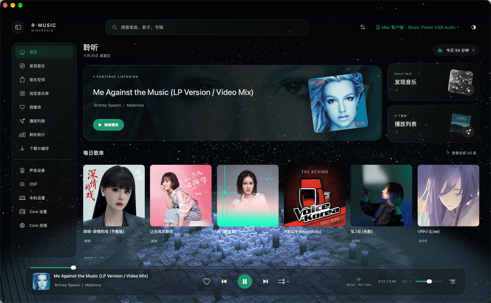
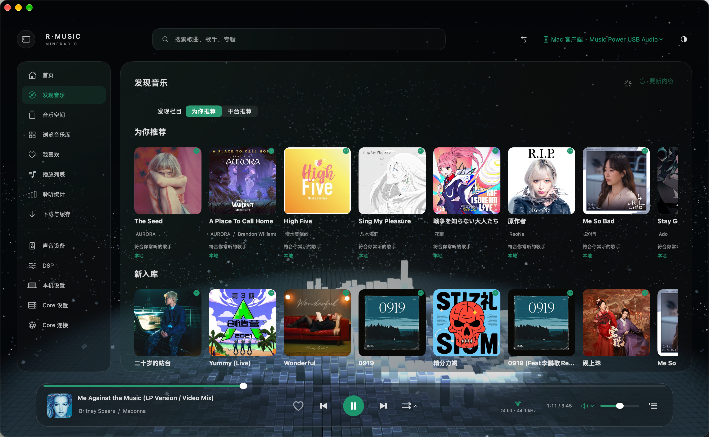
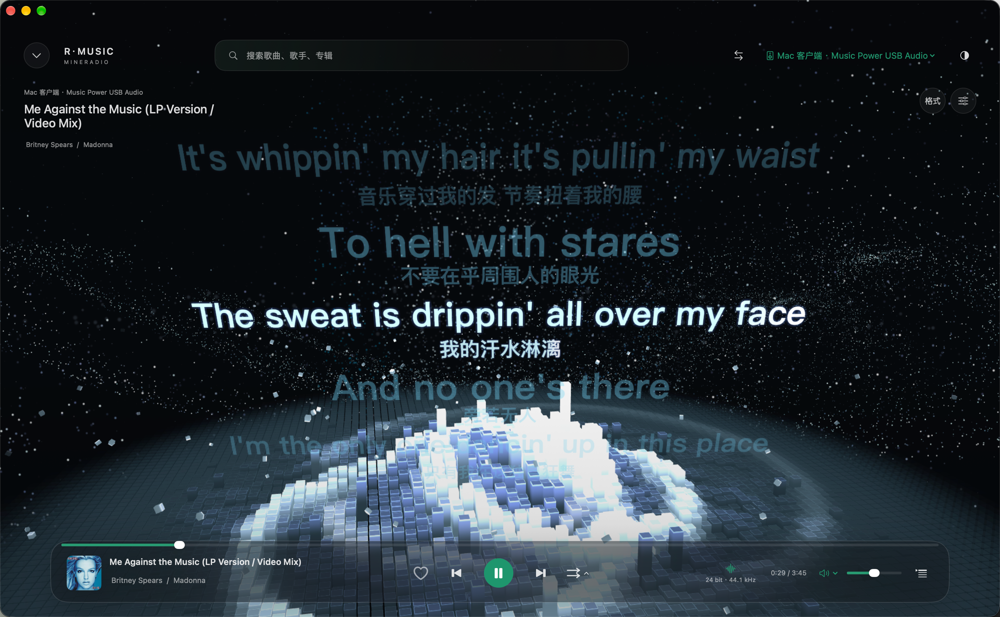
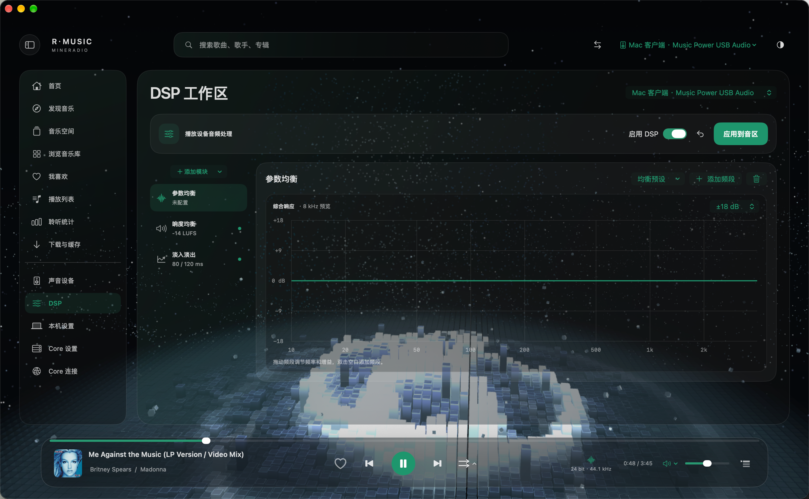

# R-Music

R-Music 是自托管音乐系统。一个 Core 管理曲库、账号、播放队列和音区，Web、Mac 与 Android 可以浏览音乐、控制现有音区或使用自己的播放输出。

**0.1.0 Preview 1** 是首个公开版本，适合在家用 Linux 或 NAS 上部署和体验。

## 快速开始

1. 前往 [Releases](https://github.com/ddgsdde/RMUSIC1/releases) 下载适合主机架构的 Core 镜像。
2. 按 [Docker Compose 部署说明](docs/deployment.md) 启动 Core，打开 Web 界面并创建管理员。
3. 添加 `/music` 曲库路径，或在 Core 中配置在线音源。Mac、Android 客户端连接同一个 Core。

| 平台 | 下载与要求 |
| --- | --- |
| Linux / NAS | amd64、arm64 Docker 镜像与 Compose 配置 |
| macOS | Apple Silicon、macOS 27+。播放需要 FFmpeg 和 FFprobe。预览 DMG 使用 ad-hoc 签名 |
| Android | ARM64、Android 8.0+。通过 GitHub Releases 安装签名 APK |

## Mac 界面

| 发现音乐 | 播放与同步歌词 |
| --- | --- |
|  |  |

## 功能

- 本地与在线音源、专辑和歌手、收藏、普通及智能歌单。
- 根据实听记录生成每日歌单，从当前歌曲查找相似曲目。Core 支持配置兼容 OpenAI API 的模型供应方。
- 跨客户端同步队列、音区、进度与歌词，支持原音频缓存和响度均衡。

可选在线音源使用自己的平台账号。音乐由用户自行添加，在线内容的版权及使用条件由对应平台决定。

## 构建与许可

Core 使用根目录的 Dockerfile 或 [Compose 本地构建](docs/deployment.md)。客户端见 [macOS 构建](macos/README.md)和 [Android 构建](docs/android.md)。

项目采用 [AGPL-3.0-or-later](LICENSE)，各组件保留 [第三方许可证与署名](THIRD_PARTY.md)。
